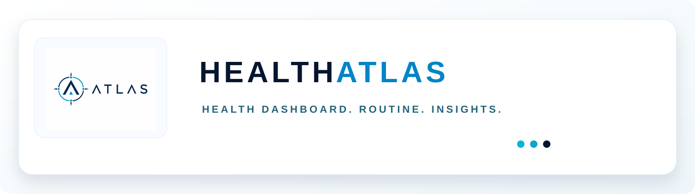

<p align="center">
  
</p>

# RH Healthcare / Health Atlas

Health Atlas는 건강 데이터 수집·정규화·분석 및 관련 서비스 운영을 위한 저장소입니다. 구형 독립 게임 시제품과 Unity 개발 코드는 별도 비공개 게임 저장소로 분리 관리합니다.

## 구성

```text
apps/
  health-app/   # Android Health Connect 연동 및 건강 관리 앱
  health-web/   # 웹 건강 대시보드
packages/
  shared-auth/
  shared-profile/
  shared-types/
  game-link-sdk/  # 기존 파생 데이터 연동의 호환 계층
  design-system/
supabase/
  migrations/
```

## RH Healthcare

- Android Health Connect 권한 및 공급자 데이터 동기화
- 일일 활동, 수면, 회복 및 주요 건강 지표의 정규화
- AI 코칭, 개인 분석, 소셜 및 관리자 기능
- 원본 건강 기록을 외부 게임에 직접 제공하지 않는 파생 데이터 경계

## 실행과 검증

```bash
npm install
npm run dev:health
npm run dev:health-web
npm run build:health
npm run build:health-web
npm run typecheck:health
npm test
```

## 환경변수와 데이터베이스

`.env.example`을 참고하되 비밀 키를 클라이언트나 저장소에 커밋하지 않습니다. Supabase 데이터베이스는 이 저장소의 마이그레이션 기록과 RLS 정책을 유지합니다.

```bash
npx supabase db push
```

이미 배포된 건강·연동 관련 데이터베이스 스키마와 마이그레이션은 호환성을 위해 보존합니다. 게임 코드 이전이 DB 마이그레이션의 자동 롤백을 의미하지 않습니다.

## Health Connect

앱 설치·권한·데이터 부재·네이티브 플러그인 오류를 구분하고, 수집 원본과 화면용 집계값을 분리합니다.

## 보안 원칙

- 건강 원본 데이터는 승인되지 않은 외부 클라이언트에 전달하지 않습니다.
- 사용자별 테이블 접근은 RLS 및 필요한 RPC를 사용합니다.
- 서버 전용 키, 비밀번호, 개인 건강 기록 전체를 로그에 출력하지 않습니다.
- 배포용 자격 증명은 소스에 포함하지 않습니다.

## 관련 문서

- [모노레포 아키텍처](docs/monorepo-architecture.md)
- [Health Web 통합](apps/health-web/docs/integration-notes.md)
- [생활 시뮬레이션 모드](docs/life-sim-mode.md)

현재 게임 전용 Unity·웹 실험 코드의 활성 개발 위치는 이 공개 저장소가 아닙니다.
